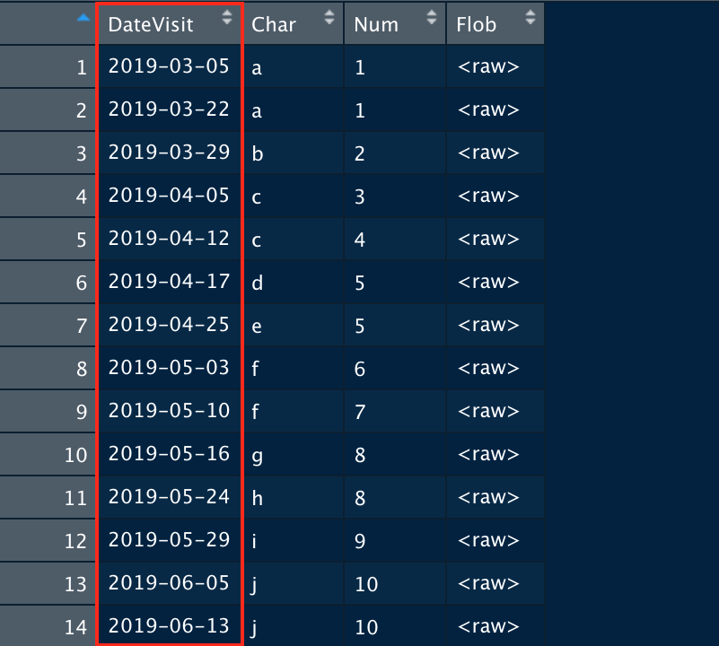
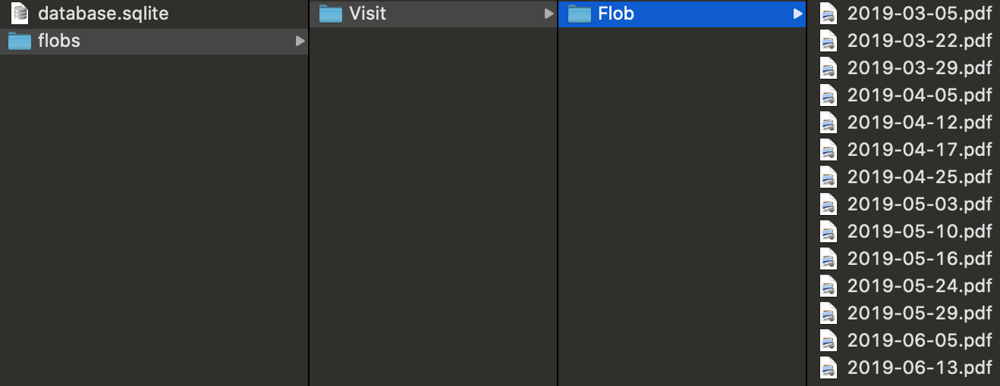
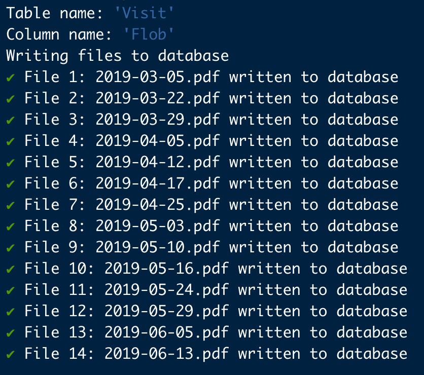

# Batching flobs

## Batch exporting and importing flobs for an sqlite database

After creating a new version of a database, it can be time consuming to
re-populate flobs individually using the slobr app. dbflobr provides
functionality to carry out this task automatically with minimal user
input, and provides useful console output to summarize the results. Lets
assume you have a database containing one or more tables with Blob
columns.

### Saving flobs from a database

Create a connection to your database and run the function
[`dbflobr::save_all_flobs()`](https://poissonconsulting.github.io/dbflobr/reference/save_all_flobs.md)
providing the database connection and the file path you have chosen for
storing the flobs. dbflobr will automatically use the table’s primary
key as the file name for each saved flob. In this example, ‘DateVisit’
is the unique primary key

  
  

Flobs are stored in sub-directories named after the tables and columns
they originated from. This preserves all of the information necessary to
repopulate a new version of the database into the correct locations.

  
  

### Importing flobs back into a database

After a new version of the database has been created, run the function
[`dbflobr::import_all_flobs()`](https://poissonconsulting.github.io/dbflobr/reference/import_all_flobs.md),
providing the connection to the new database and the file path to the
directory in which all of your flobs are stored. dbflobr will repopulate
the database using the file and directory names to import each flob to
the correct cell.

### Working with individual tables and columns

If you only want to export and import flobs from particular tables or
columns you can use
[`dbflobr::save_flobs()`](https://poissonconsulting.github.io/dbflobr/reference/save_flobs.md)
and
[`dbflobr::import_flobs()`](https://poissonconsulting.github.io/dbflobr/reference/import_flobs.md)
respectively, providing the additional arguments ‘table_name’ and
‘column_name’ as needed.  
  
